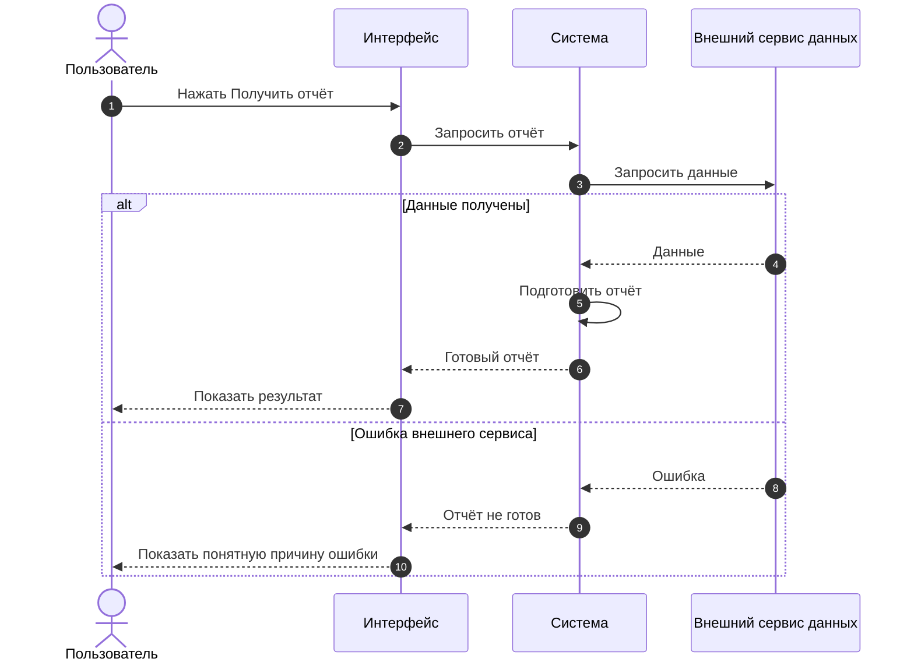

# Необязательная визуализация логики проекта

Добавлено в 1.3.0. Диаграмма помогает обсуждать ТЗ и результаты работы;
основные требования и критерии приёмки остаются в каноническом документе.

## Оценка и предложение

Во время проработки ТЗ текущая модель один раз оценивает выбранный сценарий.
Диаграмма полезна, если по тексту трудно понять порядок действий, участников,
интеграции, ожидание результата, существенную развилку или изменение состояния.
Для простой локальной правки она обычно не нужна. Отдельный вызов модели,
маршрутизатор, установка инструмента и числовой рейтинг полезности не требуются.

Предложение должно назвать сценарий, тип и пользу. Пример:
«Для сценария “Получить отчёт” полезна sequence-диаграмма: она покажет,
куда идёт запрос и что увидит пользователь при ошибке внешнего сервиса.
Добавить её к ТЗ?» Задай этот необязательный вопрос через доступный механизм
ввода; продолжай независимую разрешённую работу. Отсутствие ответа не является
согласием и не останавливает основной процесс. Прямой запрос на диаграмму
уже разрешает её создание. После отказа не повторяй предложение для того же
сценария; используй ранее принятую настройку проекта.

Названная пользователем модель может участвовать только при явном выборе и
доступном способе вызова. Не меняй ведущую модель и не включай автоматическое
делегирование ради этой оценки.

| Вопрос для обсуждения | Подходящий вид |
| --- | --- |
| Что происходит от действия пользователя до результата, какие системы вызываются? | Sequence — предпочтительный первый вид |
| Какое решение выбирает следующую ветку процесса? | Блок-схема / flowchart |
| Как объект переходит между состояниями и какие переходы допустимы? | Диаграмма состояний |

Выбери один вид для одного сценария. Добавляй второй только если он отвечает
на другой существенный вопрос или пользователь его запросил.

## Что должно быть видно

- Действие пользователя, интерфейс и итог, который пользователь наблюдает.
- Участники с понятными именами; вызов интеграции и её ответ, когда они нужны
  для понимания сценария. Самовызов может показать внутренний расчёт.
- Существенная ошибка, тайм-аут, асинхронное ожидание или повтор — только если
  они установлены требованиями. Не придумывай retry, endpoint, оплату или доступ.
- Ссылка на текущие REQ/AC либо раздел ТЗ, охваченный сценарием.
- Статус: **планируемое поведение**, **предложение** или **проверенная часть**.
  Для проверенной части укажи реальное доказательство и его область. Успешный
  разбор Mermaid не подтверждает доступность интеграции или работу продукта.

Открытую развилку пометь как вопрос или предположение. Предложенный провайдер
не становится действующей интеграцией от появления на схеме. Не представляй
запрещённый или не подтверждённый путь как готовое решение.

Храни принятый вид в текущем ТЗ или в связанном `docs/diagrams/`, если такая
структура уместна. Не заводи вторую спецификацию. При изменении сценария
сначала обнови требования, затем схему и приёмку. Устаревший вид пометь явно.

## Тестовый пример sequence

**Статус: демонстрация планируемого поведения.** Это вымышленный сценарий,
а не утверждение о работающей интеграции или её API. Для реального проекта
замени участников и подписи на данные его ТЗ; укажи связанные требования.

Сначала пользователь нажимает кнопку. Система обращается к внешнему сервису,
готовит отчёт из полученных данных и показывает результат. При ошибке она
показывает причину; пример не устанавливает правила автоматических повторов.

## Формат и проверка

Предпочитай Mermaid в Markdown: исходник остаётся редактируемым и может
показываться прямо в поддерживающем интерфейсе. Если рендерер недоступен,
предоставь исходник и короткое текстовое объяснение. Не заявляй, что схема
отрисована или проверена, если это не выполнялось. Не загружай проектные
данные в публичный редактор или внешний сервис ради экспорта без разрешения.

При наличии подходящего рендерера проверь синтаксис и читаемость выбранного
вида. Для sequence сверяй стрелки запросов/ответов, ветки и пользовательский
результат с ТЗ. Документированные Mermaid API `parse` и `render` проверяют
синтаксис и отображение, а не реальный порядок вызовов системы. Достаточно
одной подходящей проверки; не запускай широкий набор тестов ради рисунка.

В отчёте назови сценарий, ссылку на источник, статус поведения и фактически
выполненную проверку. Не включай диаграмму во все отчёты автоматически.

Официальные справки: [sequence syntax](https://mermaid.js.org/syntax/sequenceDiagram.html)
и [usage / parse / render](https://mermaid.js.org/config/usage.html).
